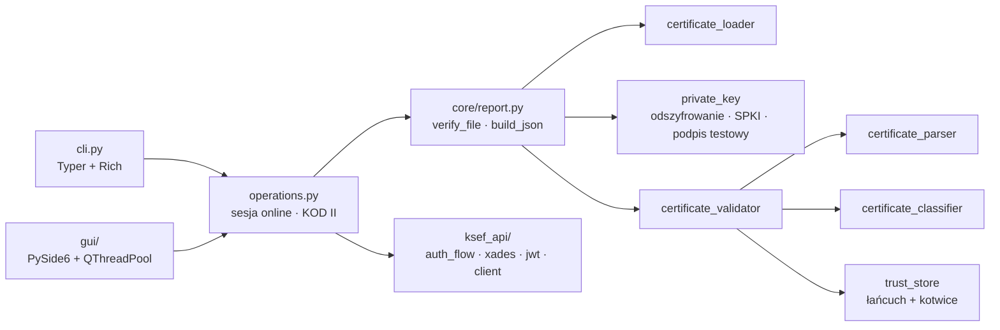

# KSeF CertVerify

[](https://suppi.pl/zvgelo)


**KSeF CertVerify** – *Weryfikacja certyfikatów KSeF*: narzędzie (GUI + CLI) do weryfikacji certyfikatów **KSeF 2.0**
typu `Authentication` i `Offline` (certyfikat do podpisu KODU II) **razem z kluczem prywatnym**. Działa **domyślnie offline**,
na Linuxie i Windowsie, bez uprawnień administratora.

> **KSeF CertVerify nie jest oficjalną aplikacją Ministerstwa Finansów** ani nie jest z nim powiązany.


| Jasny motyw (zaufanie niepotwierdzone) | Ciemny motyw (CA skonfigurowane) |
|---|---|
|  |  |

> Zrzuty pochodzą z danych **syntetycznych** wygenerowanych lokalnie – to nie są certyfikaty KSeF.

## Trzy niezależne wyniki

Wynik **nie** jest jednym ogólnym słowem, które coś ukrywa. Program pokazuje trzy osobne grupy:

| Grupa | Co obejmuje | Wynik |
|---|---|---|
| **LOCAL** – zestaw CERT + KEY + PASSWORD | odczyt certyfikatu, daty, kompletność danych, odszyfrowanie klucza, dopasowanie klucza (SPKI), **aktywny test podpisu** | `Zestaw certyfikatu i klucza – POPRAWNY / NIEPOPRAWNY / NIEJEDNOZNACZNY` |
| **TRUST** – zaufanie i profil KSeF | podpis wystawcy i łańcuch, zaufany CA (skonfigurowany przez Ciebie), typ, profil KSeF | `Zaufanie do certyfikatu – POTWIERDZONE / NIEPOTWIERDZONE / ODRZUCONE` |
| **ONLINE** – status w KSeF | status w API (`Active`/`Blocked`/`Revoked`/`Expired`), uwierzytelnienie XAdES, autoryzacja | niezależny od LOCAL |

Poprawny zestaw cert + klucz przy nieustalonym CA to **LOCAL: POPRAWNY, TRUST: NIEPOTWIERDZONE** – a pełna walidacja
**nie** jest `VALID`. `UNKNOWN` nigdy nie staje się `PASS`. Wynik online nie zmienia wyników lokalnych.

**`VALID` oznacza wyłącznie lokalne spełnienie kryteriów – nie oznacza aktywnego statusu w KSeF ani potwierdzenia przez MF.**

### Pełna weryfikacja = certyfikat + klucz + hasło

1. certyfikat X.509 (np. `KSeF_Ksiegowosc.crt`), 2. **zaszyfrowany** klucz prywatny (`KSeF_Ksiegowosc.key`), 3. hasło (ukryty prompt –
nigdy argument polecenia). Klucz niezaszyfrowany to **problem bezpieczeństwa** (`FAIL`, chyba że świadomie `--allow-unencrypted-key`).
Odszyfrowany klucz nie jest nigdzie zapisywany.

### Ważne ograniczenie: brak oficjalnego CA

Ministerstwo Finansów **nie publikuje** certyfikatów CA wystawiających certyfikaty KSeF ani certyfikatów referencyjnych
([TECHNICAL_FINDINGS](docs/TECHNICAL_FINDINGS.md)). Zaufane CA dodajesz sam (`ksef-cert-verify trust add`, GUI „Zaufane CA…”, każde
z potwierdzeniem odcisku SHA-256). Bez nich zaufanie to `NIEPOTWIERDZONE`. Kotwicą jest identyczny certyfikat (DER), nigdy nazwa wystawcy.

## Funkcje

* **Test podpisu** (RSA 2048 / EC P-256): losowe dane z CSPRNG podpisane kluczem i zweryfikowane kluczem z certyfikatu
  (`SIGNATURE_VALID`, `SIGNATURE_INVALID`, `KEY_DECRYPTION_FAILED`, `KEY_CERT_MISMATCH`, `UNSUPPORTED_ALGORITHM`).
* **Test KODU II** (certyfikat Offline): podpis wg `kody-qr.md` na danych syntetycznych (RSA-PSS / ECDSA P1363).
* **Automatyczne uwierzytelnienie w KSeF** (certyfikat Authentication): challenge → `AuthTokenRequest` → podpis **XAdES** → status →
  `accessToken` (JWT) → zapytanie o status certyfikatu. Środowisko TEST domyślnie, PROD tylko po jawnym potwierdzeniu.
* **Istniejący JWT** (opcja zaawansowana): wstępna kontrola struktury i terminu ważności (dekodowanie to nie dowód autentyczności).
* Status online dopasowuje certyfikat po numerze seryjnym **i** metadanych (typ, daty, CN, identyfikator) – sam HTTP 200 nie wystarcza.

## Instalacja

| System | Pakiet | Instrukcja |
|---|---|---|
| Windows 10/11 x64 | `KSeF-CertVerify-<wersja>-win-x64-setup.exe` – **Setup** (instalator Inno Setup) | [INSTALL_WINDOWS](docs/INSTALL_WINDOWS.md) |
| Windows 10/11 x64 | `KSeF-CertVerify-<wersja>-win-x64-portable.exe` – **Portable** (GUI, jeden plik) | [INSTALL_WINDOWS](docs/INSTALL_WINDOWS.md) |
| Windows 10/11 x64 | `ksef-cert-verify-<wersja>-win-x64-cli.exe` (samodzielne CLI, jeden plik) | [INSTALL_WINDOWS](docs/INSTALL_WINDOWS.md) |
| Linux (dowolna) | `KSeF-cert-verify-<wersja>-linux-x86_64.AppImage` | [INSTALL_LINUX](docs/INSTALL_LINUX.md) |
| Fedora | `ksef-cert-verify-<wersja>-1.x86_64.rpm` | [INSTALL_LINUX](docs/INSTALL_LINUX.md) |
| Debian / Ubuntu | `ksef-cert-verify_<wersja>_amd64.deb` | [INSTALL_LINUX](docs/INSTALL_LINUX.md) |
| Python (pip) | `pip install ".[gui]"` | [INSTALL_LINUX](docs/INSTALL_LINUX.md) / [WINDOWS](docs/INSTALL_WINDOWS.md) |

**Setup czy Portable?** *Setup* instaluje aplikację (menu Start, PATH, odinstalowanie, szybszy start). *Portable* to jeden plik EXE uruchamiany bez instalacji z dowolnego miejsca (np. z pendrive’a) – przy każdym starcie rozpakowuje się do katalogu tymczasowego użytkownika i po zamknięciu sprząta po sobie.

Stan budowania i testów pakietów: [docs/PACKAGING.md](docs/PACKAGING.md).

## Szybki start

```bash
ksef-cert-verify verify --cert KSeF_Ksiegowosc.crt --key KSeF_Ksiegowosc.key --trust-anchor ca.pem
ksef-cert-verify verify --cert KSeF_Ksiegowosc.crt --key KSeF_Ksiegowosc.key --online --environment test
ksef-cert-verify test-signature --cert KSeF_Ksiegowosc.crt --key KSeF_Ksiegowosc.key
ksef-cert-verify test-auth      --cert KSeF_Ksiegowosc.crt --key KSeF_Ksiegowosc.key --environment test
ksef-cert-verify test-kod2      --cert KSeF_Offline.crt    --key KSeF_Offline.key
ksef-cert-verify inspect KSeF_Ksiegowosc.crt        # tylko podgląd, bez werdyktu
ksef-cert-verify gui
```

```text
KSeF CertVerify – KSeF Certificate Verification
Certificate type:  Authentication
Private key:       KSeF_Ksiegowosc.key
Password:          PROVIDED

LOCAL – zestaw certyfikat + klucz + hasło
Certificate:          PASS
Signature test:       PASS  Podpis losowych danych testowych (ECDSA-P256-SHA256) ...
TRUST – zaufanie do wystawcy i profil KSeF
Issuer trust:         NOT CHECKED  Nie skonfigurowano punktów zaufania ...
ONLINE – status w KSeF (nie wpływa na wyniki lokalne)
KSeF API status:      NOT CHECKED

Zestaw certyfikatu i klucza: VALID    POPRAWNY (VALID)
Zaufanie do certyfikatu:     UNKNOWN  NIEPOTWIERDZONE
FULL VERIFICATION: INDETERMINATE
```

Kody wyjścia: `0` poprawny · `1` niepoprawny · `2` błąd wykonania/argumentów · `3` niejednoznaczny.

## Dokumentacja

* [CLI](docs/CLI.md) · [GUI](docs/GUI.md) · [Pakowanie i instalatory](docs/PACKAGING.md)
* [Instalacja – Linux](docs/INSTALL_LINUX.md) · [Instalacja – Windows](docs/INSTALL_WINDOWS.md)
* [Reguły walidacji](docs/CERTIFICATE_VALIDATION.md) · [Ustalenia z dokumentacji MF](docs/TECHNICAL_FINDINGS.md)
* [Testy](docs/TESTING.md) · [Bezpieczeństwo](docs/SECURITY.md)

## Architektura



CLI i GUI wywołują **ten sam** silnik. Eksport JSON z GUI jest równoważny `verify --json` (porównanie sparsowanych dokumentów
w teście E2E) przy tych samych ścieżkach plików i tym samym zegarze (`--at`).

## Licencja

MIT – zob. [LICENSE](LICENSE).
