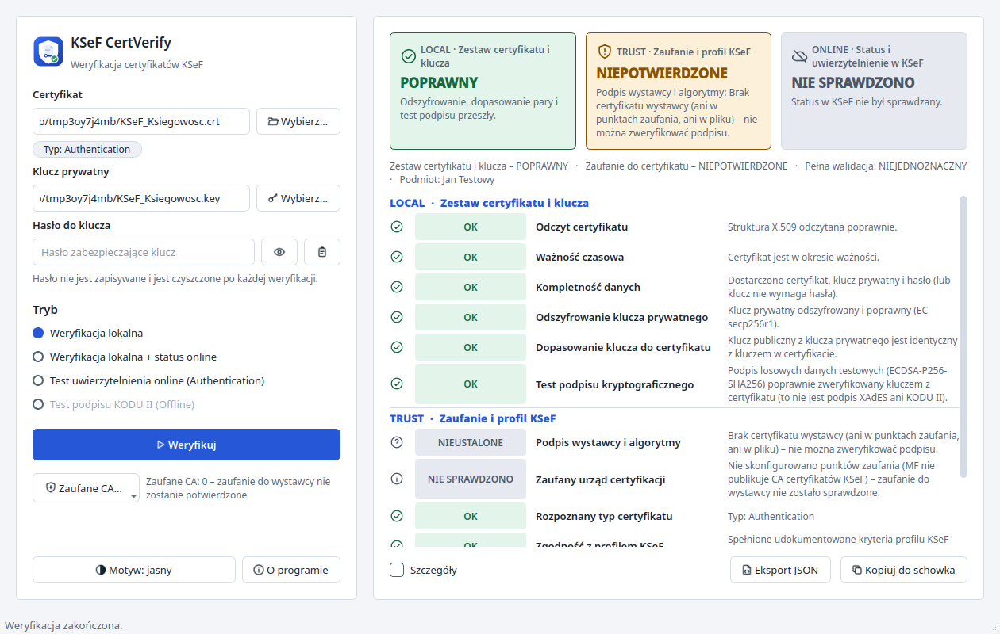
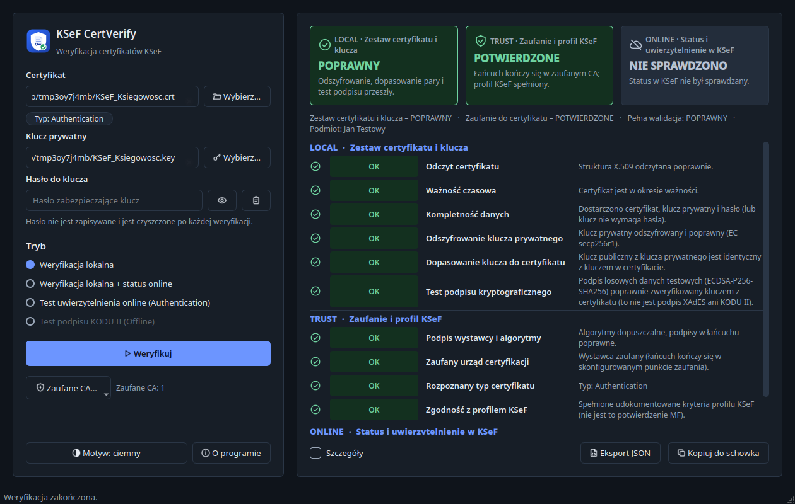

# GUI – KSeF CertVerify

Uruchomienie: `ksef-cert-verify gui`, `ksef-cert-verify-gui`, skrót **KSeF CertVerify** w menu systemowym albo AppImage.

| Jasny | Ciemny |
|---|---|
|  |  |

Projekt wizualny (skill `frontend-design`): tokeny kolorów, odstępów i typografii w `gui/theme.py` (QSS stosowany do całej aplikacji,
więc także okna dialogowe), jednolity zestaw ikon SVG w `gui/assets/icons` (check-circle, shield-check, alert-triangle, cloud-off,
x-circle i ikony przycisków; kolory z aktualnego motywu, ostre na HiDPI), logo w `packaging/assets`.

## Dane wejściowe (lewy panel)

* **Certyfikat** (`.crt .cer .pem .der`, także `.p12/.pfx`) – po wskazaniu program rozpoznaje typ (znacznik „Typ: Authentication/Offline”).
* **Klucz prywatny** (`.key`/`.pem`) i **Hasło do klucza** (ukryte; „oko” pokazuje/ukrywa, „schowek” wkleja). Hasło nie jest zapisywane
  i jest czyszczone po każdej weryfikacji. Przeciągnięcie plików na okno uzupełnia pola.
* **Zaufane CA…** – dodawanie CA wymaga potwierdzenia odcisku SHA-256 i certyfikatu z `CA=TRUE`.

## Tryb

| Tryb | Co robi |
|---|---|
| Weryfikacja lokalna | LOCAL + TRUST, bez sieci |
| Weryfikacja lokalna + status online | j.w. + status w KSeF; dla Authentication – **automatyczne uwierzytelnienie** (XAdES) |
| Test uwierzytelnienia online (Authentication) | tylko uwierzytelnienie, bez zapytania o status; dostępne tylko dla Authentication |
| Test podpisu KODU II (Offline) | podpis KODU II na danych syntetycznych; dostępne tylko dla Offline |

Opcje online: **Środowisko** TEST (domyślnie) / DEMO / PROD – wybór PROD pokazuje ostrzeżenie i wymaga wpisania słowa `PROD`;
**Kontekst (NIP)** (domyślnie NIP z certyfikatu); **Automatyczne uwierzytelnienie w KSeF**. W sekcji **Zaawansowane**:
**Użyj istniejącego tokena JWT** (z objaśnieniem: co to jest accessToken i skąd pochodzi; wstępna kontrola struktury i terminu ważności;
autentyczność weryfikuje dopiero API). Certyfikat Offline nie oferuje uwierzytelnienia XAdES.

## Wynik (prawy panel)

Trzy karty **LOCAL / TRUST / ONLINE** z ikoną, słowem statusu i krótkim powodem; poniżej sekcje z kontrolami (ikona + słowo + opis).
Nigdy sam kolor: ✓ OK, ✗ BŁĄD, ! UWAGA, ? NIEUSTALONE, – NIE SPRAWDZONO są zawsze podane tekstem. Wynik online nie zmienia kart LOCAL i TRUST.
Pod kartami: „Zestaw certyfikatu i klucza – …”, „Zaufanie do certyfikatu – …”, „Pełna walidacja: …”.
**Szczegóły**, **Eksport JSON** (równoważny `verify --json`), **Kopiuj do schowka**, **Motyw** (systemowy/jasny/ciemny, zapamiętywany),
**O programie** (nazwa, opis, wersja z metadanych aplikacji – ta sama co w CLI i instalatorach, licencja oraz odnośnik do repozytorium GitHub otwierany w domyślnej przeglądarce; adres jest stałą z `pyproject.toml`, a nie odczytem lokalnego `git remote`). Teksty z certyfikatów i nazw plików są wyświetlane jako zwykły tekst (bez HTML), bez znaków sterujących i bidi.
High DPI: skalowanie ułamkowe Qt 6; ikona okna i paska zadań (Windows: własne AppUserModelID).
