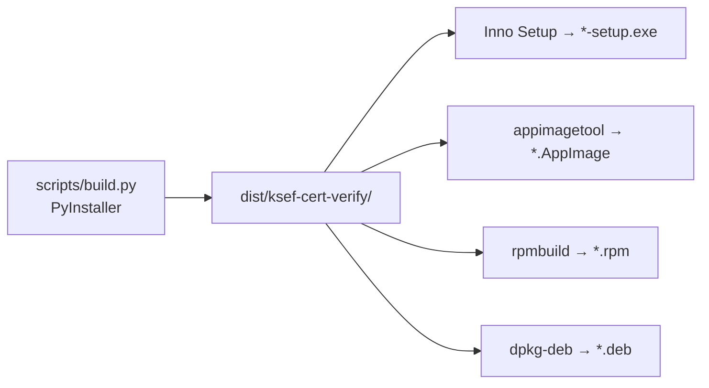

# Pakowanie i instalatory

Jeden mechanizm: `scripts/build.py` buduje **payload** PyInstaller (`dist/ksef-cert-verify/` z dwoma plikami wykonywalnymi:
`ksef-cert-verify` – CLI i `ksef-cert-verify-gui` – GUI, wspólne biblioteki Qt) według jednej specyfikacji
`packaging/ksef-cert-verify.spec`. Instalatory tylko pakują ten sam payload.

```text
packaging/
├── ksef-cert-verify.spec        # jedyna specyfikacja PyInstaller
├── entry_cli.py  entry_gui.py
├── assets/                      # icon.svg/.png/.ico, ksef-cert-verify.desktop
├── windows/  KSeF-cert-verify.iss  build.ps1  test-installer.ps1
└── linux/    build.sh  container-build.sh  test-install.sh
              appimage/AppRun  rpm/ksef-cert-verify.spec  deb/{control.in,postinst,postrm}
```



## Windows: Setup, Portable i CLI

Jedno uruchomienie `packaging/windows/build.ps1` tworzy: `KSeF-CertVerify-<wersja>-win-x64-setup.exe` (Inno Setup),
`KSeF-CertVerify-<wersja>-win-x64-portable.exe` (PyInstaller `--onefile --windowed`, `packaging/ksef-cert-verify-portable.spec`) oraz
`ksef-cert-verify-<wersja>-win-x64-cli.exe` (PyInstaller `--onefile`, bez Qt, `packaging/ksef-cert-verify-cli.spec`) wraz z `SHA256SUMS`.
Testy plików portable robi `packaging/windows/test-portable.ps1` na prawdziwych procesach (okno GUI, `--selftest`, bez Pythona w PATH,
z katalogu ze spacją i polskimi znakami, kontrola sprzątania `_MEI*` i braku plików kluczy).

## Budowanie

| Cel | Polecenie | Uwagi |
|---|---|---|
| payload (onedir) | `python scripts/build.py` (`--target onedir|portable|cli|all`) | natywnie na systemie docelowym (PyInstaller nie buduje międzyplatformowo) |
| RPM | `packaging/linux/build.sh rpm` | wymaga `rpm-build` |
| DEB | `packaging/linux/build.sh deb` | wymaga `dpkg-deb` (Debian/Ubuntu) |
| AppImage | `APPIMAGETOOL=/ścieżka/appimagetool-x86_64.AppImage packaging/linux/build.sh appimage` | narzędzie pobierz z oficjalnego wydania i zweryfikuj sumę |
| Windows EXE | `packaging\windows\build.ps1` | na Windows; wymaga Inno Setup 6 |
| SHA-256 | `packaging/linux/build.sh checksums` | `dist/SHA256SUMS` |

**glibc.** Payload linkuje się z bibliotekami systemu, na którym go zbudowano; `build.sh` zapisuje wersję glibc maszyny budującej
i wstawia ją jako minimalną w zależnościach RPM/DEB. Do wydań budujemy więc na **starszym** systemie (workflow `release.yml`:
`ubuntu-22.04`, glibc 2.35). Lokalny build na nowym systemie daje pakiet działający tylko na równie nowych dystrybucjach.
`packaging/linux/container-build.sh` buduje w kontenerze Ubuntu 22.04 (używa `uv` i pobiera Pythona 3.12 – zob. komentarze w skrypcie).

W środowisku bez systemowego `libpython` (Debian/Ubuntu) potrzebny jest pakiet `libpython3.x`, a do analizy PyInstaller
`libgssapi-krb5-2`.

## Test instalacji (E2E)

* Linux: `packaging/linux/test-install.sh <deb|rpm|appimage> <plik> <katalog-z-parą>` w czystym kontenerze: instalacja →
  `--version` → pełna weryfikacja certyfikat + zaszyfrowany klucz → błędne hasło (exit 1) → `gui --selftest` (Qt offscreen) →
  `.desktop`, ikona, `desktop-file-validate` → odinstalowanie → brak pozostałości. Parę syntetyczną tworzy
  `scripts/make_fixture_pair.py` (to nie jest certyfikat KSeF).
* Windows: `packaging\windows\test-installer.ps1 -Setup <plik>`: cicha instalacja → CLI → weryfikacja → GUI `--selftest` → skrót
  w menu Start → PATH → deinstalacja → brak plików.

## Status artefaktów (stan na 2026-10-28, kod z commita „Branding KSeF CertVerify”)

| Artefakt | Zbudowany | Przetestowany | Gotowy do dystrybucji |
|---|---|---|---|
| `ksef-cert-verify-1.0.0-1.x86_64.rpm` | **tak** – lokalnie, Fedora 44 (payload glibc 2.43) | **tak** – kontener Fedora 44, 15/15 kroków `test-install.sh`: instalacja, PATH, wpis menu „KSeF CertVerify”, zasoby GUI, CLI, weryfikacja pary, błędne hasło, GUI selftest (offscreen), `desktop-file-validate`, odinstalowanie bez pozostałości | **nie** – wymaga glibc ≥ 2.43; wydanie wymaga buildu CI na starszej glibc; niepodpisany |
| `ksef-cert-verify_1.0.0_amd64.deb` | **tak** – kontener Ubuntu 24.04 (glibc 2.39) | **tak** – Ubuntu 24.04 i Debian 13, po 15 kroków PASS (to samo co wyżej) | **nie** – glibc ≥ 2.39 (nie obejmuje Ubuntu 22.04/Debian 12); niepodpisany |
| `KSeF-cert-verify-1.0.0-linux-x86_64.AppImage` | **nie** | **nie** | **nie** – wymaga pobrania `appimagetool` (nie wykonano) |
| `KSeF-CertVerify-1.0.0-win-x64-setup.exe` | w CI (wcześniejszy commit); **nie** lokalnie | CI (`windows-2025`): instalacja, CLI, GUI, odinstalowanie – PASS na wcześniejszym commicie; **brak ręcznego testu** | **nie** – wymaga ręcznego buildu/testu i zatwierdzenia |
| `KSeF-CertVerify-1.0.0-win-x64-portable.exe` | **nie** (zbudowano tylko odpowiednik Linux) | proxy Linux: bez Pythona w PATH, inny katalog, TMPDIR pusty po zakończeniu; **Windows: nie uruchomiono** | **nie** |
| `ksef-cert-verify-1.0.0-win-x64-cli.exe` | **nie** (zbudowano tylko odpowiednik Linux) | proxy Linux: wersja, weryfikacja pary, błędne hasło, `gui` → exit 2; **Windows: nie uruchomiono** | **nie** |
| `SHA256SUMS` | tak (rpm, deb) | `sha256sum -c` OK | – |
| `release.yml`, `ci.yml` | skonfigurowane (składnia YAML sprawdzona) | **nie uruchomione** | – |

Pominięte/nieuruchomione: aktualizacja pakietu w miejscu (upgrade), instalacja na Ubuntu 22.04 / Debian 12 / Fedorze innej niż 44,
rzeczywiste uruchomienie GUI na pulpicie (testy GUI są headless: Qt `offscreen`), cały Windows i AppImage.
Branding: nazwa wyświetlana „KSeF CertVerify” (menu, tytuły, metadane); nazwy plików artefaktów, pakietów (`ksef-cert-verify`) i `AppId`
pozostają niezmienione. Zasoby GUI (logo, ikony SVG) są dołączane do payloadu przez `packaging/ksef-cert-verify.spec` (`datas`).

## Wydanie

Workflow `.github/workflows/release.yml` buduje natywnie (Windows: PyInstaller + Inno Setup; Linux: AppImage, RPM, DEB), testuje
instalację w kontenerach / na runnerze Windows, liczy `SHA256SUMS` i – tylko dla tagu `v*` – tworzy **wersję roboczą** GitHub
Release po zatwierdzeniu środowiska `release`. Przed pierwszym użyciem ustaw zmienne repozytorium `APPIMAGETOOL_URL` i
`APPIMAGETOOL_SHA256` (przypięcie narzędzia) oraz wymaganych recenzentów środowiska `release`. Workflow niczego nie publikuje
samodzielnie.
